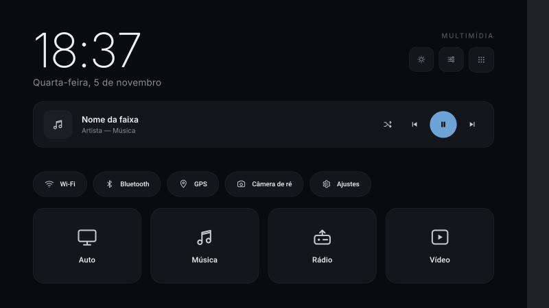
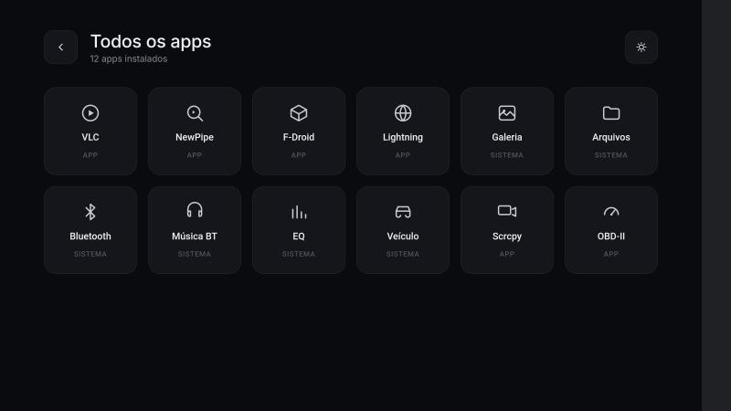

<div align="center">

# 🚗 JancarLauncher

**Launcher Android minimalista e sem root para centrais multimídia automotivas Jancar 8227L (MediaTek/Autochips AC8227L).**

[](https://kotlinlang.org)
[](https://developer.android.com/jetpack/compose)
[-3DDC84?logo=android&logoColor=white)](https://developer.android.com/about/versions/oreo)
[](#como-funciona-sem-root)
[](LICENSE)

</div>

---

## O problema

Centrais automotivas genéricas baseadas no chip **MediaTek/Autochips AC8227L** (vendidas como Jancar, entre outras marcas) vêm travadas num padrão comum a esse tipo de hardware:

- Rodam **Android 8.1 (API 27) de verdade**, mesmo quando o firmware se anuncia como "Android 12" — os fingerprints do sistema ficam inconsistentes entre si.
- **Não têm root.** `ro.secure=1`, build `user`, boot verificado.
- **Não existe seletor de launcher** nas Configurações — o app de fábrica é fixo, cheio de ícones que boa parte dos usuários nunca usa.

O JancarLauncher substitui esse launcher de fábrica por um minimalista, **sem precisar de root**, usando apenas recursos padrão do ADB.

## Como funciona sem root

| Recurso | Mecanismo | Precisa de root? |
|---|---|---|
| Trocar o launcher padrão | `adb shell cmd package set-home-activity` | Não |
| Abrir direto no boot | `BroadcastReceiver` em `BOOT_COMPLETED` + o item acima | Não |
| Instalar o app | `adb install` (a central não valida assinatura) | Não |
| Lançar Android Auto / CarPlay / Rádio / Música | `Intent` explícito para o pacote/activity de cada app já instalado na central | Não |
| Ajustar brilho do sistema (opcional) | `adb shell appops set <pacote> WRITE_SETTINGS allow`, uma vez | Não |
| Ler o "Tocando agora" | `MediaSessionManager` (permissão de acesso a notificações, concedida pelo usuário) | Não |

Nenhuma operação lê ou grava fora da sandbox do próprio app, nem depende de acesso de sistema. Tudo é reversível: existe um comando de rollback documentado em [`docs/INSTALL.md`](docs/INSTALL.md) que devolve o launcher de fábrica.

## Telas

<table>
<tr>
<td width="33%">

**Boas-vindas**
<br>Aparece ao ligar o carro ou acordar da suspensão: fundo com foto do carro (tratada em duotone), relógio, toque para continuar.


</td>
<td width="33%">

**Home**
<br>Relógio, tema claro/escuro, brilho, chips de atalho (Wi-Fi, Bluetooth, GPS, câmera de ré, Ajustes) e 4 blocos principais: **Android Auto/CarPlay**, **Música**, **Rádio**, **Vídeo**.



</td>
<td width="33%">

**Gaveta de apps**
<br>Grid com os apps secundários instalados (VLC, NewPipe, F-Droid, Lightning Browser, etc.).



</td>
</tr>
</table>

Paleta inspirada na lataria prata do carro e no acento azul-aço dos faróis de LED — ver tokens exatos em [`app/CLAUDE.md`](app/CLAUDE.md).

## Stack

- **Kotlin + Jetpack Compose**, sem XML/Views.
- `minSdk 27` (Android 8.1) — todo comportamento é validado nessa API, mesmo compilando contra uma SDK mais nova.
- Desenvolvido com TDD: lógica de lançamento de apps, políticas de boas-vindas/boot/crash e tema cobertas por testes unitários JVM (ver `app/src/test`).
- Build debug é suficiente para instalar — a central não valida assinatura de app store.

## Instalação na central

Guia completo com pré-requisitos, comando de rollback e troubleshooting: **[`docs/INSTALL.md`](docs/INSTALL.md)**.

Resumo:

```bash
adb connect <IP_DA_CENTRAL>:5555
adb install -r JancarLauncher-debug.apk
adb shell cmd package set-home-activity com.rocha.jancarlauncher/.MainActivity
```

> Guarde o comando de rollback (devolve o launcher de fábrica) **antes** de definir o nosso como HOME — está detalhado no guia de instalação.

## Status do projeto

Desenvolvido e testado em emulador (API 35, 1024×600 @160dpi). Ainda **não validado na central real** (API 27) — ver pendências e histórico de verificação em [`docs/superpowers/ledger.md`](docs/superpowers/ledger.md).

- [x] Base Compose + definição como HOME
- [x] Tema claro/escuro, tokens, componentes
- [x] Lançamento de apps (Android Auto/CarPlay/Rádio/Vídeo) com fallback seguro
- [x] Telas de Boas-vindas, Home e Gaveta
- [x] Boot automático + auto-recuperação de crash (máx. 3/min)
- [ ] Activity exata do app de Música (bloqueante, depende de `dumpsys` na central)
- [ ] Validação completa na central real

Contribuições que ajudem a resolver as pendências acima (principalmente mapeamento de pacotes/activities em centrais AC8227L) são bem-vindas.

## Hardware de referência

| Campo | Valor |
|---|---|
| Central | Jancar 8227L |
| Chip | MediaTek/Autochips AC8227L, ARMv7 32 bits |
| Android real | 8.1 (API 27) |
| RAM | 2 GB |
| Tela | 1024×600, 160 dpi |

## Build local

```bash
./gradlew assembleDebug testDebugUnitTest
```

APK gerado em `app/build/outputs/apk/debug/app-debug.apk`.

## Licença

[MIT](LICENSE) — use, modifique e redistribua livremente.
