<div align="center">

# 🚗 JancarLauncher

**Launcher Android sem root para centrais multimídia Jancar 8227L (MediaTek/Autochips AC8227L), feito para um VW Fox.**

[](https://kotlinlang.org)
[](https://developer.android.com/jetpack/compose)
[-3DDC84?logo=android&logoColor=white)](https://developer.android.com/about/versions/oreo)
[](#como-funciona-sem-root)
[](https://github.com/Rochafelip/JancarLauncher/releases/latest)
[](LICENSE)

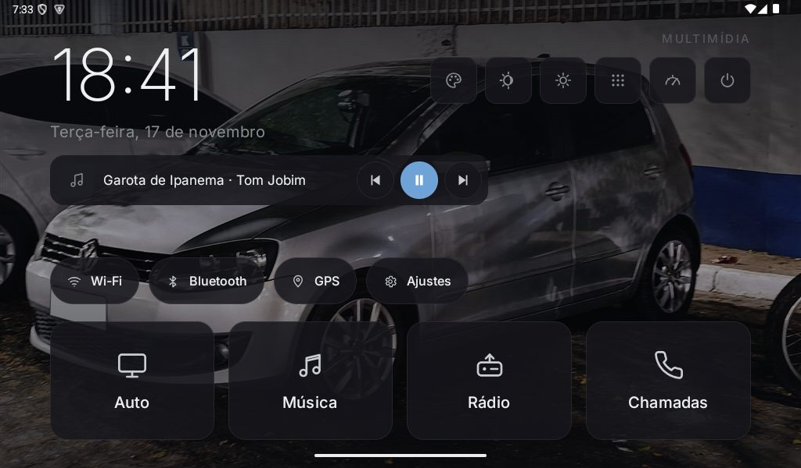

</div>

---

## O problema

Centrais automotivas genéricas baseadas no chip **MediaTek/Autochips AC8227L** (vendidas como Jancar, entre outras marcas) vêm travadas num padrão comum a esse tipo de hardware:

- Rodam **Android 8.1 (API 27) de verdade**, mesmo quando o firmware se anuncia como "Android 12".
- **Não têm root.** `ro.secure=1`, build `user`, boot verificado.
- **Não existe seletor de launcher** nas Configurações: o app de fábrica é fixo, cheio de ícones que boa parte dos usuários nunca usa.

O JancarLauncher substitui o launcher de fábrica por uma Home limpa com a foto do carro, um painel de instrumentos, diagnóstico pelo OBD-II e um player sempre à mão, **sem root**, usando só recursos padrão do Android e do ADB.

## Telas

> Capturas do emulador (1024×600 @160dpi) com dados de prévia: velocidade, música e códigos de falha são simulados.

<table>
<tr>
<td width="50%">

**Home com 12 temas**
<br>Foto real do carro ao fundo, relógio, atalhos e o **player de música ou rádio** em todos os temas (⏮ ⏯ ⏭; sem nada tocando, atalhos Música · Rádio).

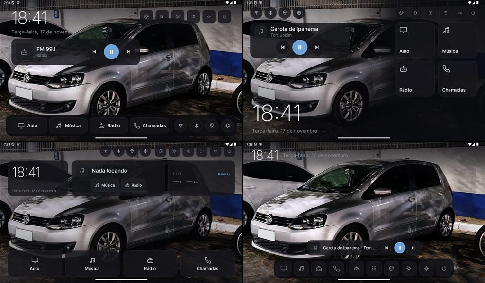

</td>
<td width="50%">

**Tema claro**
<br>Claro/escuro por toque, e modo noturno automático pelo farol do carro.

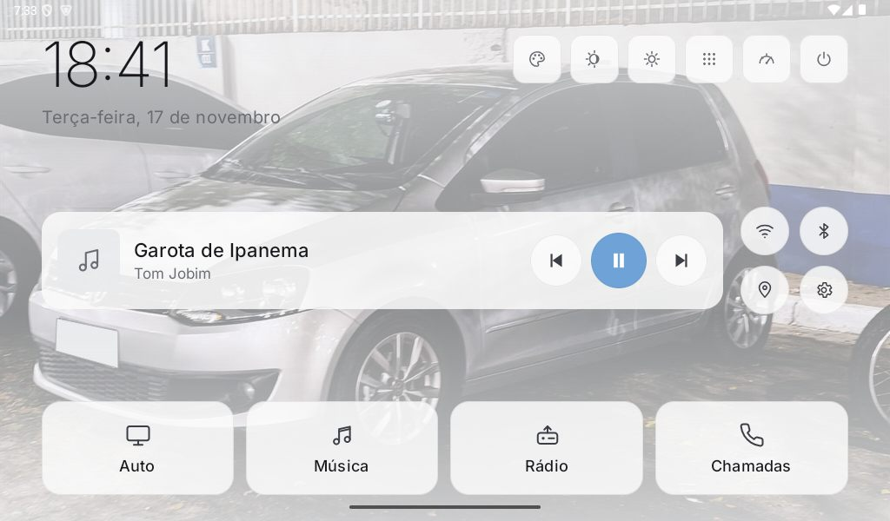

</td>
</tr>
<tr>
<td>

**Painel**
<br>Velocidade e giro grandes, aviso de troca por modo (DIA A DIA / BRAVO), marcha sugerida, consumo pelo OBD (agora e da viagem, com custo em R$), limite de velocidade com bipe e avisos só quando acontecem.

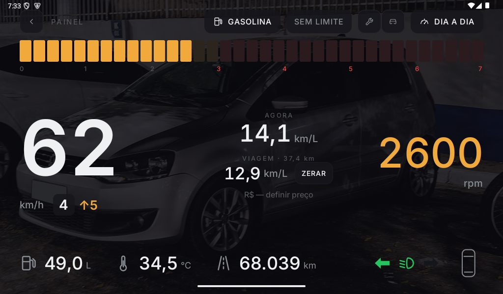

</td>
<td>

**Fox**
<br>O painel de instrumentos original redesenhado, com a foto do carro: faróis, setas e portas abertas seguem o carro de verdade (CAN).

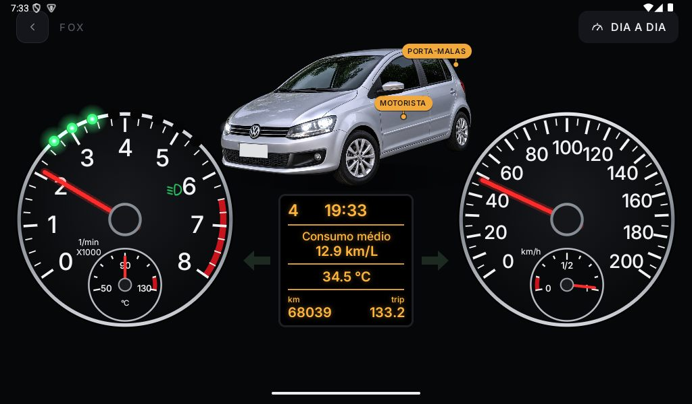

</td>
</tr>
<tr>
<td>

**Diagnóstico OBD: falhas**
<br>Lê os códigos da central do motor (confirmados, pendentes, permanentes) e a luz de injeção, com explicação em português. Só leitura e só com o carro parado.

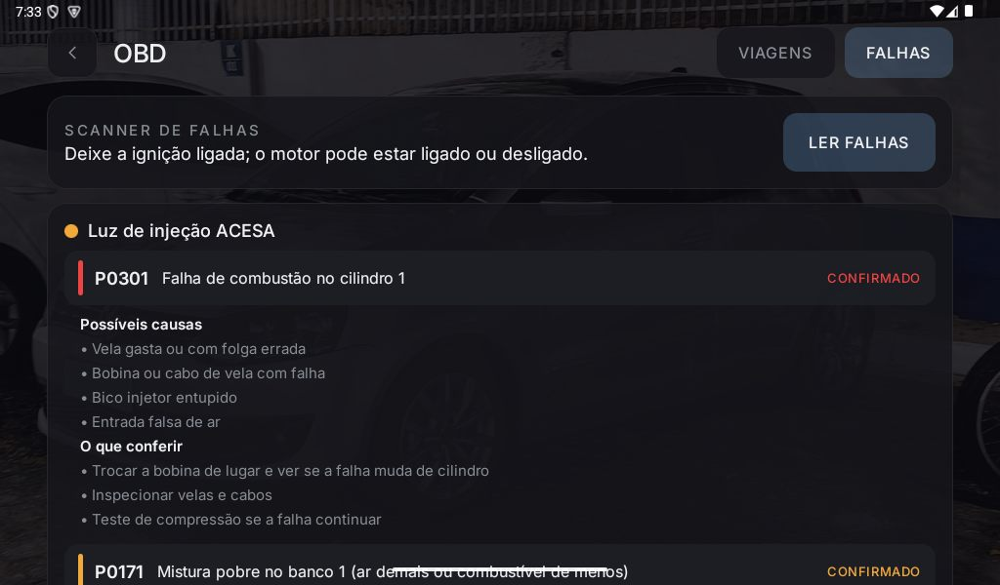

</td>
<td>

**Diagnóstico OBD: viagens**
<br>Uma viagem por ligada do carro: km, tempo, km/L, média, máxima e custo.

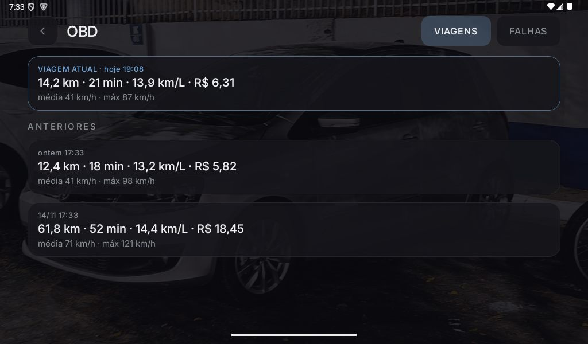

</td>
</tr>
<tr>
<td>

**Por cima do Android Auto**
<br>Cartão arrastável com velocidade, giro, consumo, marcha e o player (⏮ ⏯ ⏭), sobre o AA ou o CarPlay.

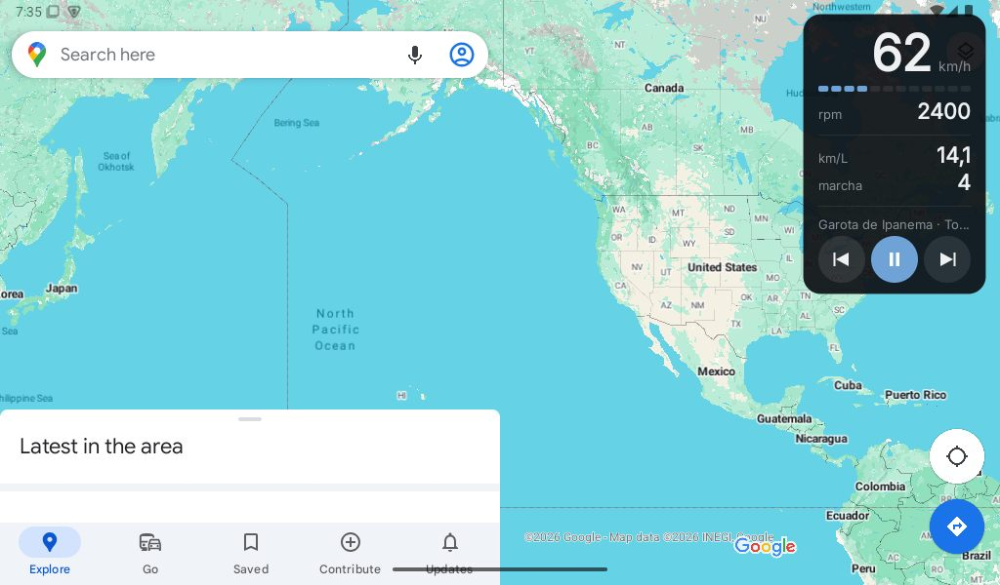

</td>
<td>

**Cor do Fox (por diversão)**
<br>Toque na foto e escolha uma de 10 cores: só a lataria muda, com reflexos e sombras preservados.

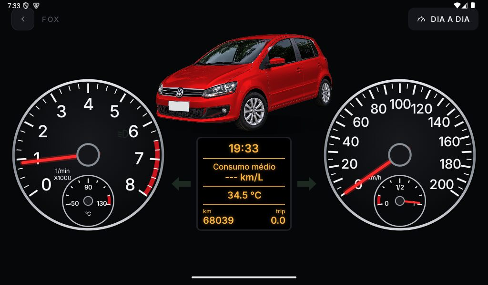

</td>
</tr>
<tr>
<td>

**Ajustes do launcher**
<br>Atualizar sem ADB (GitHub ou pendrive), retomar a música ao ligar e relatório de erros gravado na central.

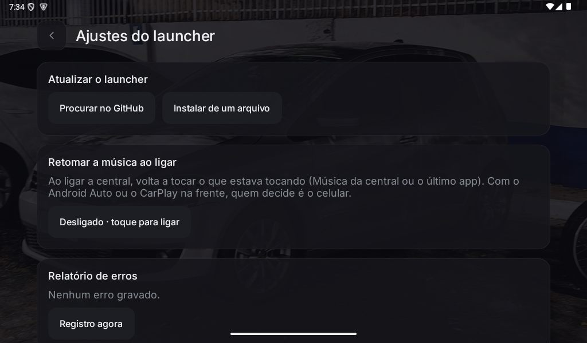

</td>
<td>

**Boas-vindas e gaveta**
<br>Boas-vindas ao ligar o carro ou acordar da suspensão; gaveta com os apps secundários.

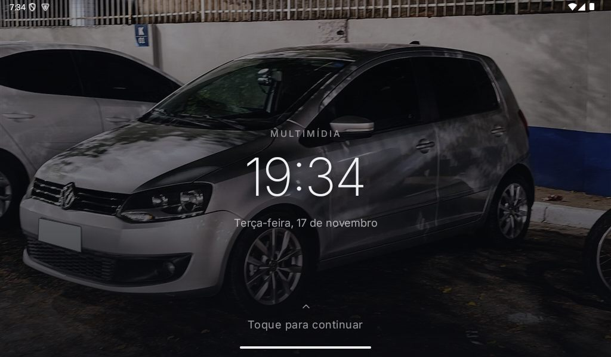 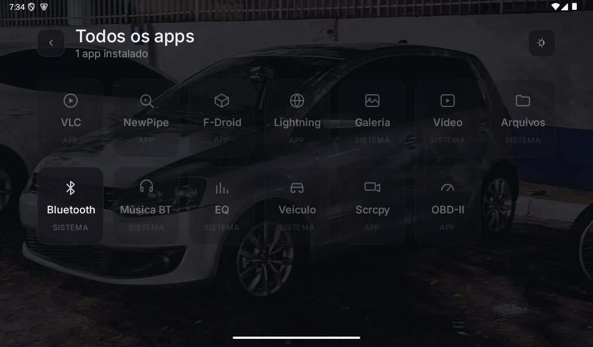

</td>
</tr>
</table>

## Como funciona sem root

| Recurso | Mecanismo | Precisa de root? |
|---|---|---|
| Trocar o launcher padrão | `adb shell cmd package set-home-activity` | Não |
| Abrir direto no boot | `BroadcastReceiver` em `BOOT_COMPLETED` | Não |
| Abrir Android Auto / CarPlay / Rádio / Música / Chamadas | `Intent` explícito para os apps da central | Não |
| Velocidade, giro, combustível, portas e setas | Serviço CAN da central (`com.can.activity`) por `Binder.transact`, só leitura | Não |
| Faixa e rádio tocando | Serviço de mídia da Jancar (`IMedia`) e `MediaSession` padrão | Não |
| Consumo, água, bateria e códigos de falha | Adaptador **ELM327 Bluetooth**, só PIDs padrão e leitura (nunca apaga códigos) | Não |
| Cartão sobre o Android Auto | `SYSTEM_ALERT_WINDOW` + `GET_USAGE_STATS`, liberados uma vez por `appops` | Não |
| Brilho do sistema | `WRITE_SETTINGS`, liberado uma vez por `appops` | Não |
| Atualizar o app pela própria central | `REQUEST_INSTALL_PACKAGES`, liberado uma vez por `appops`; só aceita a mesma assinatura e versão mais nova | Não |

Nada lê ou grava fora da sandbox do próprio app. Existe um comando de rollback em [`docs/INSTALL.md`](docs/INSTALL.md) que devolve o launcher de fábrica.

## Instalação na central

Baixe o `app-release.apk` da [última release](https://github.com/Rochafelip/JancarLauncher/releases/latest). O guia completo, com pré-requisitos, permissões opcionais e rollback, está em **[`docs/INSTALL.md`](docs/INSTALL.md)**.

```bash
adb connect <IP_DA_CENTRAL>:5555
adb install -r app-release.apk
adb shell cmd package set-home-activity com.rocha.jancarlauncher/.MainActivity
```

> Guarde o comando de rollback **antes** de definir o launcher como HOME. Depois da primeira instalação, as próximas versões entram por **Ajustes do launcher › Atualizar o launcher**, sem cabo.

## Status do projeto

Usado no carro do autor (Jancar 8227L num VW Fox 1.0). Validado na central: troca de HOME, boot, Home, Painel com o CAN (parado), setas, farol e o "Tocando agora" da Música da Jancar. Ainda **não conferido no carro**: consumo e diagnóstico pelo OBD, avisos de bateria, aviso de velocidade em movimento, rádio no player e os botões do player sobre o Android Auto. A lista atualizada fica em [`app/CLAUDE.md`](app/CLAUDE.md).

- [x] Home com 12 temas, foto do carro e player de música ou rádio
- [x] Painel e tela Fox com dados do CAN
- [x] OBD-II: consumo, viagens, custo, bateria, água e scanner de falhas
- [x] Cartão com velocidade e player por cima do Android Auto
- [x] Ajustes: atualização sem ADB, relatório de erros, retomar a música
- [ ] Testes no carro das funções novas (ver acima)

## Stack

- **Kotlin + Jetpack Compose** (`foundation`/`ui`, sem Material); o cartão sobre o AA é uma `View` desenhada à mão.
- `minSdk 27` (Android 8.1): todo comportamento é pensado para essa API, mesmo compilando contra uma SDK mais nova.
- Desenvolvido com TDD: regras puras (consumo, avisos, códigos de falha, viagens, player, temas…) cobertas por mais de 380 testes unitários JVM (`app/src/test`).
- Prévias de debug com dados simulados para cada tela (`app/src/debug`).

## Hardware de referência

| Campo | Valor |
|---|---|
| Central | Jancar 8227L |
| Chip | MediaTek/Autochips AC8227L, ARMv7 32 bits, GPU Mali-450 |
| Android real | 8.1 (API 27) |
| RAM | 2 GB |
| Tela | 1024×600, 160 dpi |
| Carro | VW Fox 1.0 8V flex; CAN pela caixa Raise (protocolo VW PQ) |

## Build local

```bash
./gradlew assembleDebug testDebugUnitTest
```

APK gerado em `app/build/outputs/apk/debug/app-debug.apk`.

## Licença

[MIT](LICENSE) — use, modifique e redistribua livremente. As fotos do carro em `app/src/main` são do autor, com a placa apagada.
